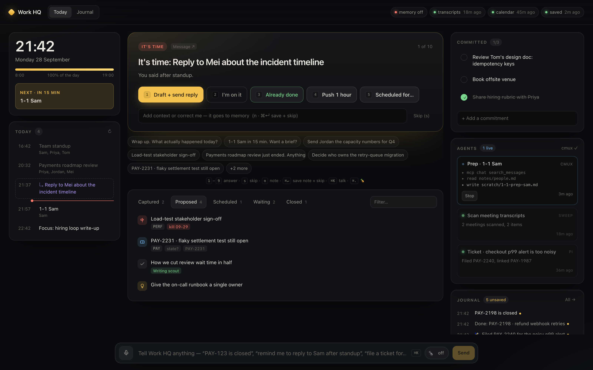
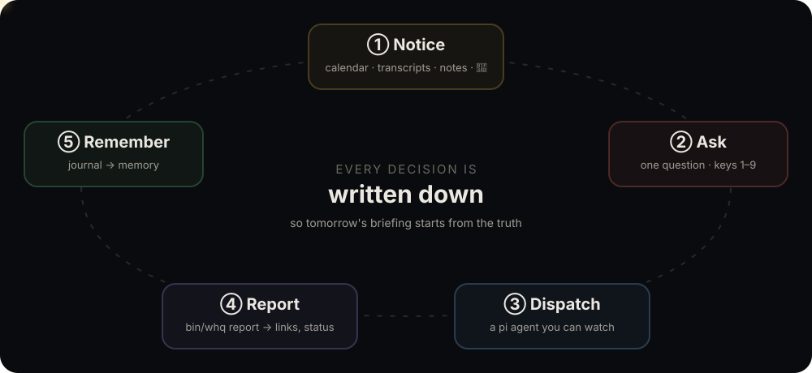
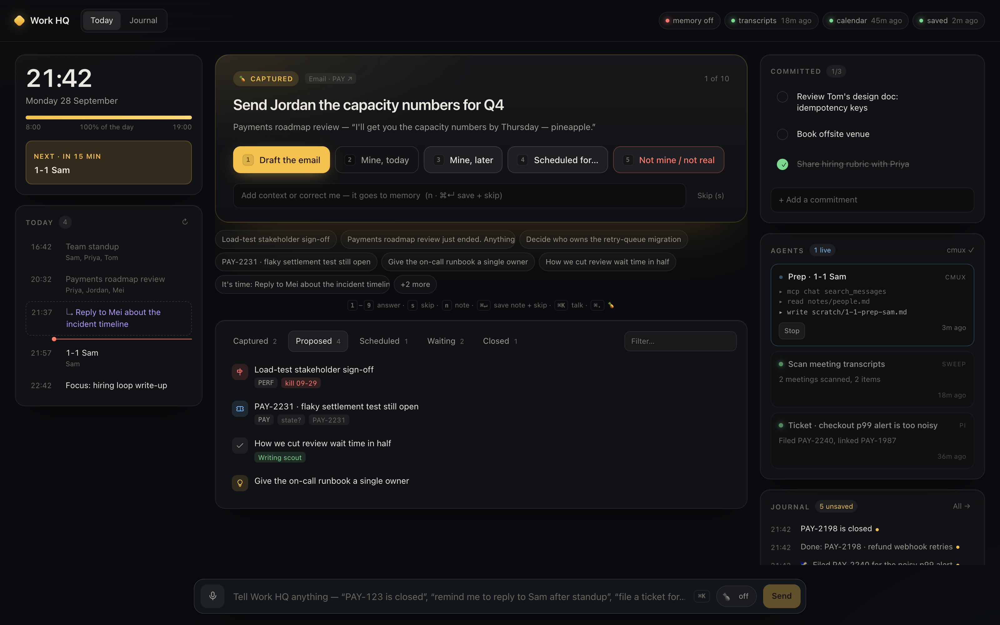
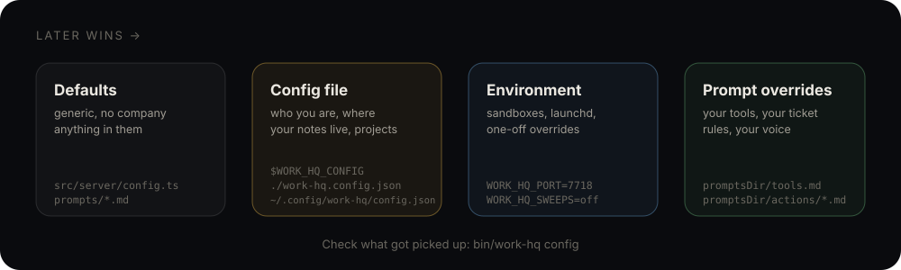
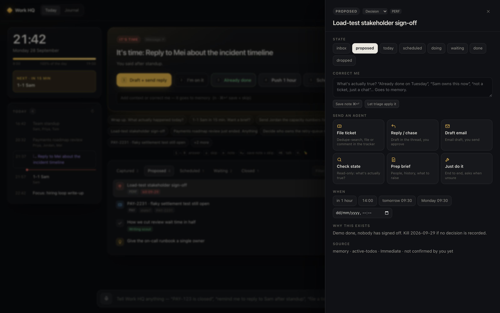
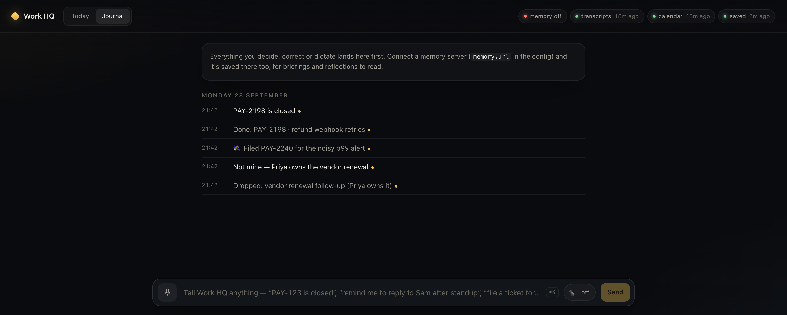
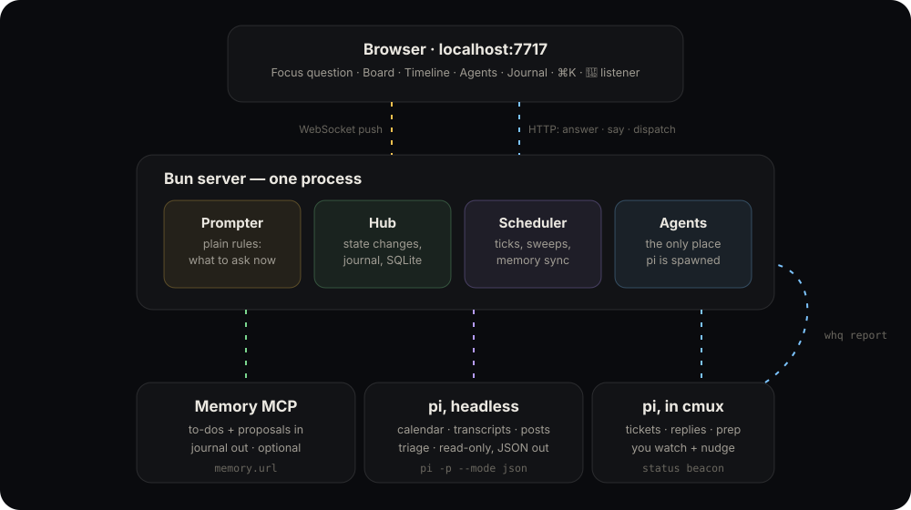

<p align="center"></p>

**Work HQ** is a local dashboard for people who juggle too many threads. It watches your
calendar, meeting notes and to-do list. It asks **one question at a time**, when the answer
matters. Pick an answer with one key and an agent goes and does the work, in a terminal you can watch.

<p align="center"></p>

<p align="center"><sub>Made-up data from <code>bin/work-hq demo</code>.</sub></p>

---

## Why

Your notes, reflections and briefings already produce good ideas. Most never turn into a ticket,
a reply or a closed loop. Items sit at *"state unknown"* for weeks because nobody asks.

Work HQ closes the loop **in the moment**:

<p align="center"></p>

| | |
|---|---|
| **Ask, don't guess** | A meeting just ended. A reminder is due. A kill date is close. Memory says "state unknown". You get one question and keys `1`–`9` to answer. |
| **Confirm, then act** | Anything that writes (a ticket, a reply, an email, a brief, "just do it") runs as a [pi](https://github.com/earendil-works/pi) session in a [cmux](https://cmux.com) tab. Watch it, nudge it, or take over. |
| **Write it down** | Every answer and correction goes into a journal, which syncs to your notes. Tomorrow's briefing starts from what's true. |

## Say 🍍 to capture

<p align="center"></p>

Turn on the listener (`⌘.`). When you say **"pineapple"** during a call, it takes the last couple
of minutes of transcript and captures the action. Your meeting-notes tool is swept every 30 minutes
as a backstop.

<p align="center"></p>

## Try it in 60 seconds

You need [Bun](https://bun.sh), macOS, and Chrome (for voice).

```bash
git clone <this repo> work-hq && cd work-hq
bun install
bin/work-hq demo          # → http://localhost:7718, made-up data, nothing real touched
```

The demo has no config, no memory and no background sweeps. Dispatched agents, sweeps and calendar
writes are scripted: they run in cmux and report back like the real thing, but touch nothing. Only the
command bar still asks pi to understand your words, and pi only ever sees the made-up items.

### Showing it to people

Click **Demo** in the top bar of your real dashboard (or press <kbd>⇧D</kbd>). Work HQ starts the sandbox as a
separate process, with its own port and a throwaway database, and the tab switches to it. Nothing is shared
with your live data, so there is no way for it to leak onto the screen. Live notifications stay quiet while
the demo runs. In the demo, a purple **DEMO** pill shows you're safe. **Reset** loads a fresh made-up day
(times are relative to now, so reset just before you start). **Exit** asks first, then takes you back and stops the sandbox.

Need a few framing slides first? The demo serves a short deck at [`/talk`](docs/talk/index.html) (`←`/`→`, `n` for speaker notes, `f` fullscreen). Its last slide jumps into the dashboard.

## Make it yours

```bash
cp work-hq.config.example.json ~/.config/work-hq/config.json   # edit: name, timezone, notes folder…
bin/work-hq config        # shows which file was loaded and every value (secrets masked)
bin/work-hq               # → http://localhost:7717
bin/work-hq install       # optional: start at login, restart if it crashes (launchd)
bin/work-hq usage         # markdown digest of the last 24h: repeats, notes that did nothing, failed runs
```

<p align="center"></p>

There are two layers to set up:

1. **The config file** says *who* and *where*: your name, timezone, work hours, notes folder,
   memory server, project keys, blog venues. Every key is optional and has a comment:
   [`work-hq.config.example.json`](work-hq.config.example.json).
2. **Prompt overrides** say *how your company works*: which MCP servers and CLIs to use, how
   tickets are filed, how replies should sound. The defaults in [`prompts/`](prompts/) are
   generic. Copy the ones you want to change into your `promptsDir`. Files you don't copy fall back to the defaults.

| Copy this… | …to teach agents |
|---|---|
| [`prompts/tools.md`](prompts/tools.md) | which tools exist: your calendar and chat MCPs, tracker CLI, code review |
| [`prompts/actions/ticket.md`](prompts/actions/ticket.md) | your ticket rules: dedupe search, project, template |
| [`prompts/actions/reply.md`](prompts/actions/reply.md) | how replies sound, and whether they need a preview |
| [`prompts/sweeps/transcripts.md`](prompts/sweeps/transcripts.md) | where meeting notes live (Gemini, Zoom, Otter…) |
| [`prompts/sweeps/calendar.md`](prompts/sweeps/calendar.md) | which calendar tool to call |
| [`prompts/sweeps/posts.md`](prompts/sweeps/posts.md) | where your wins are written down, for the weekly blog-idea scout |

Placeholders like `{{owner.name}}` and `{{tracker}}` are filled from the config. See
[`prompts/README.md`](prompts/README.md) for the full list.

### What each part needs

| Part | Needs | Without it |
|---|---|---|
| Dashboard, board, journal, command bar | Bun | — |
| Triage ("PAY-123 is closed", "remind me after standup") | [pi](https://github.com/earendil-works/pi) with a model | the command bar just journals your words |
| Calendar, transcripts, blog-idea sweeps | pi + MCPs for calendar / docs / email | nothing gets swept; you add items by hand or by voice |
| Morning checks (e.g. "merged but never landed") | any shell command that prints `{ "items": [...] }` JSON — see `checks` in the example config | nothing extra on the board |
| Dispatched actions you can watch | [cmux](https://cmux.com) | they run headless and stream into the Agents panel |
| Import to-dos, save the journal | a memory MCP with `read`/`write`/`list`/`search` over markdown | the journal stays in the local SQLite database |
| Dictation and 🍍 | Chrome (Web Speech API, no keys) | type instead |
| Better on-device dictation (optional) | [HEX](https://hex.kitlangton.dev) running — picked up automatically — or any local transcriber via `voice.command` | Web Speech |

## What it asks, and when

The rules are plain code ([`prompter.ts`](src/server/prompter.ts)). They are predictable and tested,
and cheap to run every 30 seconds. The model decides what things *mean*. The rules decide when to interrupt you.

| Badge | When | |
|---|---|---|
| **Morning plan** | first look before noon | pick today's commitments |
| **It's time** | a scheduled item is due | notifies |
| **M5 move** | the coaching card's "one thing to try" time (the last HH:MM in its *when*, else 09:30) | once per reflection: Done / Hand to an agent / Not today, journaled for tonight's reflection |
| **Meeting soon** | a small meeting or 1-1 starts in ≤ 20 min | offers a brief |
| **🍍 Captured** | you said pineapple | confirm, dispatch, or "not mine" |
| **Kill date** | ≤ 2 days to a decision deadline | |
| **Meeting ended** | ≤ 45 min after a meeting with others | "anything come out of it?" |
| **State unknown** | your notes admit they don't know | max 3 open |
| **Still waiting** | waiting on someone for > 3 days | |
| **MR merged** | waiting items whose GitLab MRs all merged | one card for all, at most daily: mark all done, one by one, or keep waiting |
| **Wrap up** | 90 min before end of day | what actually happened |
| **Post idea / Draft to review** | the weekly writing scout found something | never nags |

At most 14 questions are open at once, so it asks rather than nags. End of the day and too many left?
Press **`b`** to *clear the deck*: every question grouped by effort (one tap, hand off to an agent, needs you),
with bulk buttons per group and "push everything that needs your head to Thu". You can also say it in the command
bar: *"skip all blog posts till Thursday"*. **`q`** sorts the normal queue quick wins first. Answering *"Doing it today"*
won't bring the same question back tomorrow morning.

No button fits? Type it in the note field and press **`⌘↵`**: *"drop it"*, *"chase Sam on Thursday"*, *"it's Joan, not Jon,
and tighten it first"*. The note is the answer. Work HQ picks the matching option, changes the status, schedules it,
or sends an agent with your words. If the note is only background, it's kept on the item and the question waits
until the next working morning. **`→`** (or `s`) moves to the next card and changes nothing; **`←`** goes back.

The card you're writing on stays put. While the note field has focus or text, or you're dictating, a more urgent
question that arrives queues behind it and shows as **+N new**. The note is only cleared when you answer, send, skip
or go back. If the card closes somewhere else, your note stays in the box, flagged, so the words aren't lost.

It also tries not to ask twice. A *meeting ended* card closes itself once the transcript sweep has read that
meeting's notes. The sweep runs 10–25 min after the meeting, so most cards close before you get to them. The same
work arriving from two places (memory rewords a todo, a transcript finds what an agent already filed) becomes
one item. Something you dropped isn't brought back under a new title. Details: [architecture](docs/ARCHITECTURE.md#duplicates-across-sources-srcserverdedupets).

Set `labels.trackerUrl` and every ticket key (`PAY-123`) in a question, a card or an item becomes a link to it.

### Let your reflection tune it

`bin/work-hq usage --since <date>` prints how you actually used it: questions per kind and what you answered,
items asked more than once, every typed note and what it led to (flagged if it did **nothing** or you typed it
twice), meeting cards, merged duplicates, failed agent runs grouped by error, and what you typed into the command
bar. Point a nightly reflection at it and have it propose fixes. That's how most of the fixes above were found.

<table>
<tr>
<td width="50%"><br><sub><b>The drawer.</b> Set the state, correct what's wrong (it goes to memory), send an agent, or schedule it.</sub></td>
<td width="50%"><br><sub><b>The journal.</b> Every decision is timestamped. It outranks stale notes when the two disagree.</sub></td>
</tr>
</table>

## How it fits together

<p align="center"></p>

- **One Bun process.** HTTP, WebSocket and scheduler run together, with SQLite in `~/.local/state/work-hq/`. The UI is React, served by Bun's HTML import. No build step.
- **pi is the only thing that talks to a model.** Sweeps and triage run headless and read-only, and return JSON. Actions run interactively in cmux.
- **Agents report back over HTTP**, so anything that can POST JSON can be an agent:

```bash
bin/whq report <jobId> <<'JSON'
{ "summary": "Filed PAY-2240", "updates": [{ "id": "it_…", "status": "waiting", "links": ["https://…"] }] }
JSON
bin/whq say "PAY-2198 is closed"           # same as the command bar
bin/whq pineapple "…what was just said…"   # capture from any terminal
```

For the details and what could move to the cloud later, see [`docs/ARCHITECTURE.md`](docs/ARCHITECTURE.md).

## Safety

- **You confirm every write.** Sweeps are read-only and can't use edit/write tools. Dispatched agents are told to show drafts before sending anything to a human.
- **Model login lapses are one question, not a wall of red.** If pi's model provider login runs out (a gateway behind Cloudflare Access, say), Work HQ asks once with a **Log in now** button and pauses sweeps until it works again.
- **Local only.** The server binds to `127.0.0.1`. The only way out is through pi's own tool access.
- **Sandboxes can't pollute memory.** A non-default `WORK_HQ_DB` makes memory read-only unless you set `WORK_HQ_MEMORY_WRITE=on`. Test sentences are not facts.
- **Secrets stay out of git.** Keep the memory token in a file (`memory.tokenFile`) or an env var. Your config file is gitignored if it lives in the repo.

## Develop

```bash
bun run dev          # hot reload
bun test
bun run typecheck
bin/work-hq demo     # sandbox with made-up data (:7718)
bun scripts/screenshot.ts http://localhost:7718/ docs/img/dashboard.png   # refresh README shots
scripts/publish.sh github   # push a squashed snapshot to a mirror remote, after a denylist scan
```

Several agents editing this repo at once? Give each its own worktree, or one session's `git commit` sweeps up
another's staged hunks:

```bash
cd "$(scripts/worktree.sh new fix-thing)"     # ../work-hq-fix-thing on branch wt/fix-thing, node_modules linked
# …edit, commit…
scripts/worktree.sh land --check 'bun test'   # rebase on main, check, fast-forward the main checkout, push, clean up
scripts/worktree.sh list                      # what's in flight (never remove someone else's)
```

The server runs from the main checkout, so restart it after `land`, not before.

Dispatched work jobs don't have to remember any of this. List the repo under `repos` in your config and a work job
on an item of that project gets its own worktree before pi starts; the prompt names it, and
`bin/whq land <jobId>` lands it, runs `publish`, removes the worktree and runs `restart` (only when non-doc files
changed), printing the SHA, mirror SHA and server PID. A job that ends with nothing committed has its worktree
removed. For your own sessions in the main checkout, `git config core.hooksPath scripts/hooks` adds a pre-commit
warning whenever other worktrees are live.

<details>
<summary>Environment variables</summary>

All optional. They override the config file.

`WORK_HQ_CONFIG` (path, or `none`) · `WORK_HQ_PORT` · `WORK_HQ_DB` · `WORK_HQ_STATE` · `WORK_HQ_OWNER` ·
`WORK_HQ_TZ` · `WORK_HQ_WORKSPACE` · `WORK_HQ_PROMPTS` · `WORK_HQ_MODEL` · `WORK_HQ_PI` ·
`WORK_HQ_SWEEPS=off` · `WORK_HQ_DAY_START` / `_END` · `WORK_HQ_CALENDAR_EVERY` · `WORK_HQ_TRANSCRIPTS_EVERY` ·
`WORK_HQ_POSTS_EVERY_DAYS` · `WORK_HQ_SWEEP_SURFACE=cmux` · `WORK_HQ_CMUX_PRUNE_HOURS` · `WORK_HQ_MEMORY_URL` · `WORK_HQ_MEMORY_TOKEN` ·
`WORK_HQ_MEMORY_TOKEN_FILE` · `WORK_HQ_MEMORY_WRITE` · `WORK_HQ_CA_FILE` · `WORK_HQ_LAUNCHD_LABEL` · `WORK_HQ_TRACKER_URL`
</details>
